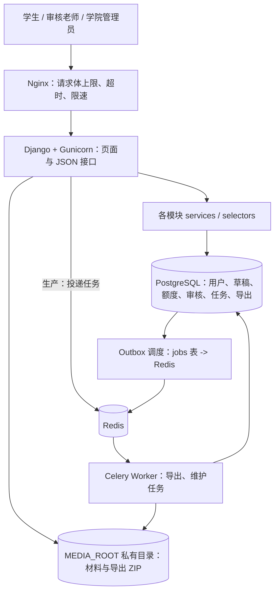
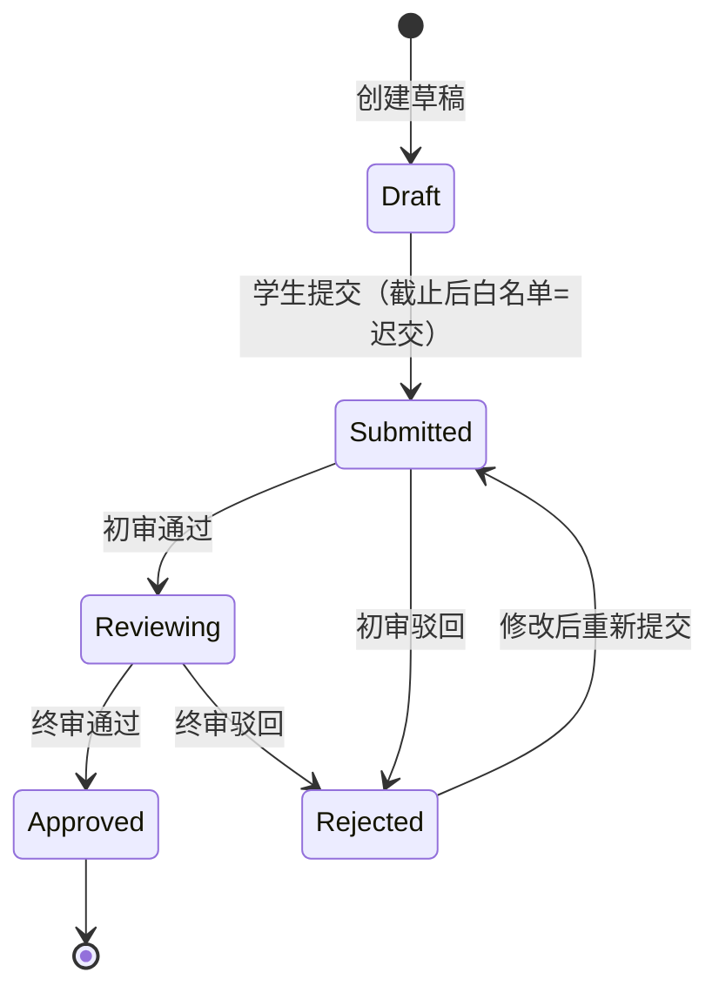
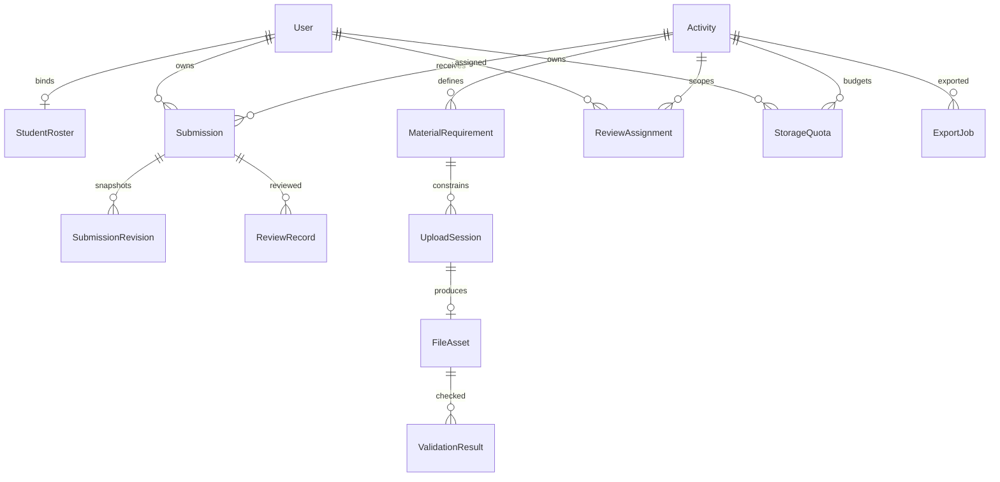

# 项目架构与模块说明

适用项目：学院社会实践材料平台（约 600 名学生的材料收集与审核）。本文对应 `mainbody` 中阶段 0~4 已收口的实现。

## 1. 交付边界

| 能力 | 状态 | 说明 |
|---|---|---|
| 账号与花名册 | 已完成 | 学号登录、自主注册（默认密码为学号后 6 位）、首次登录强制改密横幅、管理员重置密码 |
| 活动与材料规则 | 已完成 | 开放时间、班级范围、材料类别/扩展名/数量、每人 12 GiB 额度、补交白名单与补交截止 |
| 申报向导 | 已完成 | 四步向导、个人/团队申报、队员学号实时校验、草稿版本冲突返回 409 |
| 文件上传 | 已完成 | 直传 + 5MB 分片（300MB 宣讲视频）、四层校验、额度账本、跨学生越权拦截 |
| 审核 | 已完成 | 初审/终审、班级与状态筛选、行内历史时间线、驳回意见回传学生端 |
| 导出 | 已完成 | 全院 Excel 六列汇总、按班级 ZIP 流式下载、异步全活动 ZIP + 进度轮询 |
| 审计与健康检查 | 已完成 | 拒绝动作审计、请求编号、`/health/live/` 与 `/health/ready/` |
| 生产部署 | 配置完成、待目标机验证 | Dockerfile、compose、Nginx、Gunicorn 已就绪；容量结论必须在 PostgreSQL 下复跑压测 |
| 外部对象存储 / 学校统一认证 | 预留 | `integrations/storage`、`integrations/identity` 保留接口，当前文件落本地 `MEDIA_ROOT` |

功能链路已闭环，但"能在开发机跑通"不等于"600 人生产可用"。真实并发数字见 [压测报告](压测报告.md)，其中同时写明了 SQLite 开发副本的局限。

## 2. 总体架构

单一 Django 项目按业务拆模块，Web、调度、导出 Worker 分进程运行；开发/测试环境把 Celery 设为 eager，任务在 Web 进程内同步执行，链路照样完整。



上传走 Web（本地磁盘适配器），因此 Nginx 侧 `client_max_body_size` 放到 2100MB，单请求由 5MB 分片兜底；后续接 OSS 时只需替换存储适配器，接口与前端不用改。

## 3. 目录结构

```text
mainbody/
├── manage.py                     Django 命令入口
├── config/                       设置、路由、WSGI、Celery
│   └── settings/                 base / development / production / test
├── apps/
│   ├── common/                   统一响应、异常、日志、中间件、健康检查
│   ├── accounts/                 用户、花名册、注册改密、工作台上下文、页面视图
│   ├── activities/               活动、材料规则、开放与补交判定
│   ├── submissions/              草稿、版本、提交快照
│   ├── uploads/                  直传、分片、校验策略、额度、回收
│   ├── reviews/                  审核分配、审核记录、工作台查询
│   ├── validation/               检查规则与结果（预留）
│   ├── news/                     可选新闻稿（未开放页面）
│   ├── exports/                  Excel/ZIP 导出、异步任务、下载
│   ├── audit/                    审计流水与拒绝装饰器
│   └── jobs/                     持久任务、调度器、消费者
├── integrations/                 存储与身份认证适配器边界
├── templates/
│   ├── registration/             登录、注册、改密
│   ├── submissions/apply.html    四步申报向导
│   ├── reviews/workbench.html    审核工作台
│   └── dashboard.html            学生/审核/管理员工作台
├── static/
│   ├── css/app.css               全站样式
│   ├── js/apply-wizard.js        向导交互、FilePond、分片上传
│   └── vendor/                   FilePond 与 Tabler 本地副本（不用 CDN）
├── deploy/                       Nginx、Gunicorn 配置
├── requirements/                 依赖范围与精确快照
├── scripts/                      初始化、健康检查、结构检查、压测
├── tests/                        单元/集成测试与固定样本
├── media/                        运行期材料与导出产物（不进 Git）
├── Dockerfile
├── compose.yaml
└── compose.dev.yaml
```

文档在仓库根的 `docs/`（`mainbody` 之外），`scripts/check_structure.py --write-index` 会把逐文件清单写到那里。

## 4. 阶段 1~4 新增模块

### 4.1 静态资源本地托管（`static/vendor`）

| 资产 | 版本 | 用途 |
|---|---|---|
| FilePond | 4.32.12 | 拖拽上传、进度、类型/大小/像素校验、图片预览、EXIF 纠正、视频海报 |
| Tabler | 1.7.3 | 页面 UI 框架（样式 + 交互脚本） |

**为什么不用 CDN**：校园网出口对境外静态资源不稳定；断网演示、内网部署必须能开；版本与内容需要可审计（供应链风险）；页面不应把学生 IP 暴露给第三方。

引入规范：

1. 只放压缩版运行库与必要插件，原文件、版本号、来源 URL、许可写进同目录 `README.md`；
2. 模板统一用 `` 引用，禁止页面里写外链；
3. 新增库时同步补 `scripts/check_structure.py` 的 `PURPOSES`，否则结构检查会报 "Missing purpose description"；
4. 不手改压缩文件；升级时整包替换并更新 README 与文件清单。

### 4.2 学生申报向导

`templates/submissions/apply.html` + `static/js/apply-wizard.js`：

- 四个 `data-step="1..4"` 区块：项目信息、申报方式与队员、附件上传、确认提交；
- 第 2 步的队员学号通过 `GET /api/students/lookup/?student_number=...` 实时校验（账号优先、花名册回退），返回 `exists/real_name/class_name/source`；
- 第 3 步每个材料一个 FilePond 实例：小文件走 `/api/v1/uploads/direct-upload/`，300MB 宣讲视频自动切 5MB 分片；
- 保存草稿走 `POST /student/submissions/save/`（页面）或 `PATCH /api/v1/submissions/<id>/`（接口），带 `expected_version`，陈旧版本 409；
- 提交后页面转只读锁定，工作台显示"已提交"；被打回则解锁可改，并展示驳回意见。

### 4.3 分片上传接口一览

| 接口 | 方法 | 请求 | 成功响应 |
|---|---|---|---|
| `/api/v1/uploads/chunk-start/` | POST | JSON：`material_type`、`filename`、`file_size`、`total_chunks`、`requirement_id` | 201：`upload_id`、`chunk_size`(5MB)、`total_chunks`、`received_chunks`、`expires_at`、`resumed: false`；断点续传返回 200 且 `resumed: true` |
| `/api/v1/uploads/chunk-upload/` | POST | multipart：`upload_id`、`chunk_index`、`chunk` | 200：`received`、`chunk_index`、`skipped`（重复分片幂等跳过） |
| `/api/v1/uploads/chunk-complete/` | POST | JSON：`upload_id`、`material_type` | 200：`status: uploaded`、`final_path`、`actual_bytes`、`detected_type`、`checksum_algorithm/value` |

实现要点（`apps/uploads/chunks.py`）：

- 分片落 `media/tmp/<upload_id>/`，按序号补齐；同一片重复上传直接跳过，实现断点续传；
- 合并按序读回、边写边算 SHA-256，落最终键 `<activity_id>/<student_number>/<material_dir>/<uuid4().hex><ext>`；
- 合并后整份文件再走一次魔数 + 容器校验（ZIP 结构 / 图片结构 / ffprobe 可用时探测视频流），失败即删文件并回滚额度；
- `chunk-complete` 内完成额度结算（`StorageQuota.used` 增、`reserved` 减），并删除 `tmp/<upload_id>/`；
- 非本人 upload_id 一律 403；片面缺片 400；超额 409。这些拒绝都会写审计。

### 4.4 审核工作台

`templates/reviews/workbench.html` + `apps/reviews/selectors.py`：

- 查询参数：`activity_id`、`class_name`、`status`、`late=1`，只返回被分配班级的提交；
- 每行有徽章、项目信息、附件预览/下载、`data-bs-target="#history-<id>"` 折叠历史；
- 审核动作 `POST /reviews/submissions/<uuid>/action/`：`decision=approved|returned`，驳回必须填 `comment`；
- 状态推进：初审通过 -> 待终审；终审通过 -> 终审通过；任一环节驳回 -> 打回修改，审核记录形成可追溯时间线；
- 终审仅学院管理员可操作，审核老师只做初审。

### 4.5 导出：同步流 + 异步任务链

| 场景 | 入口 | 行为 |
|---|---|---|
| 全院 Excel 汇总 | `GET /api/v1/exports/activities/<id>/excel/` | 六列汇总（学号、姓名、班级、项目、类别、状态），流式 `.xlsx` |
| 按班级 ZIP | `GET /api/v1/exports/activities/<id>/zip/?class_name=...` | 目录 `{班级}/{姓名}-{学号}-{项目}/...`，流式下载 |
| 班级列表 | `GET /api/v1/exports/activities/<id>/classes/` | 已申报班级下拉数据 |
| 异步全量 ZIP | `POST /api/v1/exports/start/` -> 202 `job_id` | 建 `ExportJob`，投递 Celery；页面每 2 秒轮询 |
| 进度 / 下载 | `GET /api/v1/exports/status/<job_id>/`、`GET /api/v1/exports/<job_id>/download/` | 返回 `percent/total/current/file_path`；完成才给下载 |

异步链路：`start_export` -> `create_activity_export_job`（落库 pending）-> `export_activity_submissions.delay` -> worker 里 `run_activity_export_job` 逐份写 ZIP（更新 `current/total`）-> 产物写 `MEDIA_ROOT/exports/<activity_id>/<uuid>.zip`，状态置 `done`。ZIP 内层目录为 `{学号}_{姓名}/{材料中文标题}/{文件名}`，迟交材料文件名加 `late_` 前缀。开发/测试环境 `CELERY_TASK_ALWAYS_EAGER=True`，POST 返回时任务已执行完，行为与生产一致，只是同步。

## 5. 状态机与徽章



数据库真实状态只有 5 个：`draft`、`pending_first_review`、`pending_final_review`、`final_approved`、`returned`。代码里 `Status.SUBMITTED` 是 `pending_first_review` 的别名，`Status.APPROVED` 是 `final_approved` 的别名，便于测试与页面读。

徽章是展示口径，不是第九个状态：

| 徽章 code | 文案 | 颜色 | 触发条件 |
|---|---|---|---|
| `draft` | 草稿 | 灰 | 尚未提交 |
| `pending_first_review` | 已提交 | 蓝 | 已提交、待初审 |
| `pending_final_review` | 复审中 | 黄 | 初审通过、待终审 |
| `final_approved` | 通过 | 绿 | 终审通过 |
| `returned` | 驳回 | 红 | 任一环节驳回 |
| `late_submitted` | 迟交已提交 | 紫 | `is_late_submission=True` 且状态为草稿/待初审/待终审；导出文件名加 `late_` 前缀 |

补交分支不新增状态：截止后只有白名单学生能写，提交时置 `is_late_submission=True`，状态仍走 `pending_first_review`，工作台与导出按徽章区分。

## 6. 各模块与主要文件职责

完整逐文件清单见 [文件清单](文件清单.md)。下表只解释关键边界。

| 模块 | 关键文件 | 负责实现什么 |
|---|---|---|
| common | `api.py`、`errors.py` | 会话认证、JSON 解析、统一错误信封 `{error:{code,message},request_id}`、繁忙 503 |
| common | `middleware.py`、`logging.py` | 请求编号、结构化日志（不记正文/查询串/Cookie） |
| common | `health.py` | 进程存活与数据库/缓存就绪检查 |
| accounts | `models.py` | 自定义用户（字符串学号、角色、`must_change_password`）、`StudentRoster` |
| accounts | `services.py` | 注册（默认密码=学号后 6 位）、改密、重置为默认密码 |
| accounts | `permissions.py` | 学生/审核/管理员判定，拒绝即写审计 |
| accounts | `views.py` | 注册/登录/改密页面、两个工作台上下文、申报保存与提交页面入口、审核动作页面入口 |
| activities | `models.py` | 活动时间、班级范围、补交白名单、每人额度、`MaterialRequirement` |
| activities | `selectors.py` | 可参与活动、开放判定（截止后非白名单 409） |
| submissions | `services.py` | 创建/保存草稿（行锁 + `expected_version`）、提交校验与快照、团队防重 |
| submissions | `models.py` | 每人每活动一份、版本号、`draft_data`、`is_late_submission`、徽章属性 |
| uploads | `policies.py` | 文件名消毒、32 字节魔数、MIME 一致性、图片/ZIP 结构、ffprobe 降级 |
| uploads | `services.py` | 直传落盘、额度预留与结算、必交材料校验、可访问性判定 |
| uploads | `chunks.py` | 分片会话、幂等续传、按序合并、SHA-256、临时目录清理 |
| uploads | `retention.py` | 过期上传回收：清分片、退额度、置 aborted、写审计 |
| reviews | `selectors.py` | 审核范围、班级选项、工作台行（含 history 与 badge） |
| reviews | `services.py` | 初审/终审推进、驳回必须带意见、终审限管理员 |
| exports | `services.py` | Excel/ZIP 流、异步任务写产物、导出条目排序与 late 前缀 |
| exports | `tasks.py` | Celery 任务入口：按活动导出并回写进度/失败原因 |
| audit | `decorators.py`、`services.py` | 拒绝动作统一落审计（user/action/target/ip/reason） |
| jobs | `dispatcher.py`、`tasks.py`、`registry.py` | 持久任务领取、租约、退避、幂等消费与允许的任务类型 |

## 7. 配置、页面与外部服务

| 位置 | 作用 |
|---|---|
| `config/settings/base.py` | 安装模块、数据库、缓存、日志、`UPLOAD_CHUNK_BYTES=5MB`、单用户同时上传数、额度兜底 |
| `config/settings/development.py` | 本机调试；`DEV_SQLITE=1` 或数据库不可达时回落 SQLite，可用 `DEV_SQLITE_PATH` 指定副本；Celery eager |
| `config/settings/test.py` | 测试默认 PostgreSQL，`TEST_SQLITE=1` 切 SQLite；关闭 ffprobe，避免依赖本机二进制 |
| `config/settings/production.py` | 密钥/域名校验、HTTPS Cookie、HSTS、代理信任、Celery 非 eager |
| `config/urls.py` | 页面路由与 `/api/v1/{accounts,activities,submissions,reviews,uploads,exports}/` |
| `templates/registration/*` | 登录、注册、改密三页 |
| `templates/submissions/apply.html` | 四步申报向导 |
| `templates/reviews/workbench.html` | 审核工作台（筛选、徽章、历史、操作） |
| `templates/dashboard.html` | 学生/审核/管理员共用工作台骨架 |
| `static/js/apply-wizard.js` | 向导切换、队员校验、FilePond 五类材料、分片上传 |
| `deploy/nginx.conf`、`deploy/gunicorn.conf.py` | 请求体上限、超时、限速、worker 与线程数 |
| `integrations/storage/` | 分片存储协议；当前本地磁盘实现，接 OSS 时新增适配器 |
| `integrations/identity/` | 学校统一认证/名单激活预留位置 |

## 8. 数据关系



`SubmissionRevision.snapshot` 在提交时固化项目信息、队员、附件 UUID 与规则版本，之后改草稿不影响已提交版本；`FileAsset` 记录实际字节、检测类型与 SHA-256，导出与审核都按它取文件。

## 9. 并发、额度与故障处理

| 问题 | 已有措施 | 边界 |
|---|---|---|
| 两个页面同时保存 | `select_for_update` + `expected_version`，陈旧版本 409 | SQLite 下无真实行锁，PostgreSQL 用例单独标记 |
| 重复创建草稿 | 用户+活动唯一约束 + `get_or_create` | 每人每活动仅一份，团队共用队长账号提交 |
| 多人抢同一活动额度 | 用户行锁 -> 额度行锁 -> 预留；约束兜底 | 额度 12 GiB/人/活动 |
| 分片重复/乱序 | 分片按序号落盘、重复幂等跳过、合并前校验齐全 | 缺片 400，需补传 |
| 大文件占内存 | 5MB 分片、流式读写、合并后立即删临时目录 | 单文件上限 10GB |
| 恶意文件 | 文件名消毒、魔数、MIME、容器结构、ZipSlip/炸弹、ffprobe | 随机字节伪装视频会被拒 |
| 越权读/删 | 归属校验，非本人 403 并审计 | 管理员/审核老师按角色放行 |
| 导出阻塞 Web | 小范围同步流式；全量走 Celery + 进度轮询 | 开发 eager 下表现为同步 |
| Redis 不可用 | 任务先落库，调度器有限重试 | 单实例，无跨机房 |
| 瞬时异常 | 统一 503 + `Retry-After`，连接与锁等待有上限 | 不承诺任意故障不中断 |

压测结论只认目标环境的数字：开发机 SQLite 是单写队列，`docs/压测报告.md` 已标注；600 人规模必须在 docker compose + PostgreSQL 下用 `scripts/stress_test.py` 复跑。

## 10. 后续修改入口

| 要改什么 | 去哪里 |
|---|---|
| 页面布局、颜色、导航 | `templates/`、`static/css/app.css`、`static/vendor` |
| 材料种类/扩展名/数量/截止 | 优先后台配置；必要时 `apps/activities/` |
| 新增申报字段 | `apps/submissions/services.py` 校验 + 向导模板/脚本；要检索就建模型字段 |
| 接学校统一认证 | `integrations/identity/`、`apps/accounts/` |
| 换 OSS/S3 | 新增 `integrations/storage/oss.py`，实现同一协议后切换选择器 |
| 新增检查规则 | `apps/validation/rules.py` 注册，上传服务里调用 |
| 审核流程加签/多轮 | `apps/reviews/`；需调整"一版本一结论"的约束 |
| 导出加列/换格式 | `apps/exports/services.py` |
| 队列与重试 | `apps/jobs/registry.py`、相关任务、compose worker |
| 性能与部署参数 | `config/settings/base.py`、`deploy/`、`compose.yaml`，按压测结果调 |
| 查看全部文件 | [文件清单](文件清单.md) |

## 11. 文档依据

实现边界参考 [Django 行锁文档](https://docs.djangoproject.com/en/5.2/ref/models/querysets/#select-for-update)、[Django 测试文档](https://docs.djangoproject.com/en/5.2/topics/testing/)、[Celery 任务与幂等说明](https://docs.celeryq.dev/en/stable/userguide/tasks.html)、[Celery 配置](https://docs.celeryq.dev/en/stable/userguide/configuration.html)、[FilePond 文档](https://pqina.nl/filepond/docs/)、[Tabler 文档](https://tabler.io/docs)。这些资料支撑设计选择，不代表本项目已完成生产容量验证。
