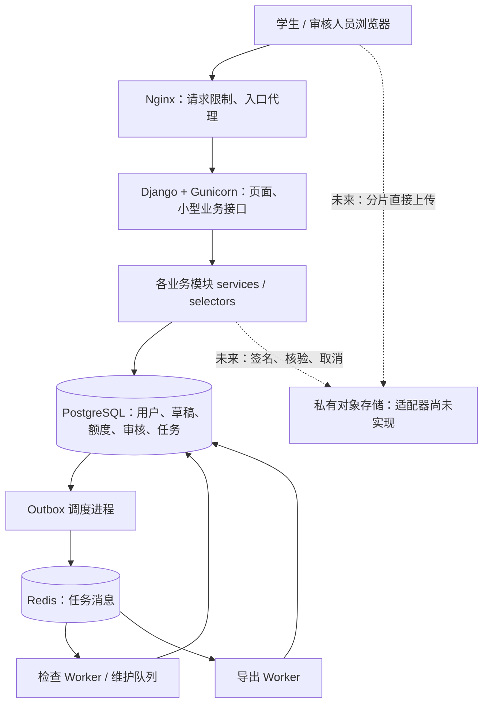
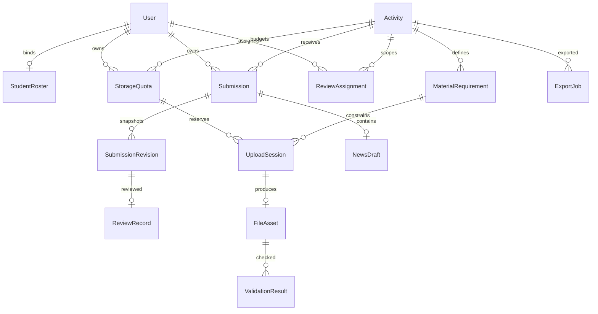

# 项目架构与模块说明

适用项目：学院社会实践材料平台。使用对象约 600 余人，收集申请表和实践成果。本文对应 `mainbody` 中已生成的项目骨架。

## 1. 当前交付边界

| 状态 | 已生成的内容 |
|---|---|
| 可继续运行和开发 | 项目入口、环境配置、数据库模型与初始迁移、登录页、管理后台注册、基础模板和样式 |
| 已有基础实现 | 活动查询、草稿创建与保存、账号归属校验、草稿版本冲突处理、额度预留与本地取消、事务审计 |
| 已有基础实现 | 数据库持久任务、有限重试、重复消费保护、任务诊断命令、健康接口 |
| 已有接口或数据结构 | 对象存储、学校认证、正式提交快照、教师审核、文件规则检查、新闻稿和批量导出 |
| 配置已生成 | Docker 镜像、Compose 服务拆分、Gunicorn 限制、Nginx 小请求限制与示例限速 |
| 尚未完成 | 真实文件直传、学生激活/找回、完整学生页面、正式审核流程、扫描器、导出器、正式部署和负载测试 |

未完成接口明确返回 `501 not_implemented`，不会伪造“上传成功”或“检查通过”。文件大小上限是 10GB，没有沿用参考手册里的 30GB/50GB。

## 2. 总体架构

采用按业务拆模块的单一 Django 项目。多个模块共享同一 PostgreSQL，通过服务函数协作；Web、后台检查、后台导出运行在不同进程中。后续可以独立增加 Worker 或 Web 实例，不需要先拆成多个微服务。



实线表示已经形成代码和配置边界的部分，虚线表示明确预留的文件传输链路。Web 请求只处理少量元数据，不接收 10GB 文件正文。

## 3. 目录结构

```text
mainbody/
├── manage.py                     Django 命令入口
├── config/                       环境配置、路由、WSGI、Celery
├── apps/                         按业务拆开的应用
│   ├── common/                   通用接口、异常、日志、健康检查
│   ├── accounts/                 用户、名单、角色
│   ├── activities/               活动、开放时间、材料规则
│   ├── submissions/              草稿、正式提交版本
│   ├── uploads/                  上传会话、文件元数据、额度
│   ├── reviews/                  审核分配、审核记录
│   ├── validation/               检查结果、规则接口
│   ├── news/                     可选新闻稿
│   ├── exports/                  批量导出记录
│   ├── audit/                    关键业务操作留痕
│   └── jobs/                     持久任务、调度器、消费者
├── integrations/                 外部存储、学校身份认证接口
├── templates/                    可编辑 HTML 页面
├── static/css/                   页面样式
├── deploy/                       Nginx、Gunicorn 配置
├── requirements/                 依赖范围与精确版本快照
├── scripts/                      初始化、健康检查、结构检查等工具
├── tests/                        权限、额度、任务和并发检查
├── docs/                         开发、接口、运行、验证说明
├── Dockerfile                    应用容器镜像
├── compose.yaml                  本地完整服务组合
└── compose.dev.yaml              本机 Python 开发时的数据库端口映射
```

`.venv`、`.env`、`staticfiles` 和 `__pycache__` 是本地依赖、密钥或生成物，不属于需要维护的业务源代码。

## 4. 各模块与主要文件的职责

完整的逐文件目录见 [文件清单](docs/文件清单.md)。下表解释各模块的关键文件和设计边界。

| 模块 | 文件 | 负责实现什么 |
|---|---|---|
| common | `models.py` | UUID 主键、创建与更新时间的通用父类 |
| common | `api.py`、`errors.py` | 登录检查、JSON 解析、统一错误码、繁忙响应 |
| common | `middleware.py`、`logging.py` | 请求编号和结构化日志，不记录请求正文、查询参数或 Cookie |
| common | `health.py` | 进程存活检查、数据库与消息队列就绪检查 |
| common | `admin.py` | 业务记录只读后台，避免随意编辑状态绕过服务层 |
| accounts | `models.py` | 自定义用户、字符串学号、姓名、班级、角色、学院名单 |
| accounts | `permissions.py` | 有效学生身份、学院管理员身份的统一判断 |
| accounts | `admin.py` | 用户与名单维护；没有开放任意学生注册 |
| activities | `models.py` | 活动时间、班级范围、累计额度、材料类别、扩展名、数量、规则版本 |
| activities | `selectors.py` | 按身份查询可参与活动、判断是否开放 |
| activities | `views.py`、`urls.py` | 活动查询接口；列表暂最多返回 100 条 |
| activities | `admin.py` | 在后台维护活动和材料规则 |
| submissions | `models.py` | 每人每活动一份提交、草稿版本号、正式提交快照结构 |
| submissions | `services.py` | 创建草稿、事务保存、版本冲突处理；正式提交保留未实现入口 |
| submissions | `views.py`、`urls.py` | 本人草稿接口，不信任客户端传入的用户身份 |
| uploads | `models.py` | 活动存储账本、分片会话、文件资产与检查状态 |
| uploads | `policies.py` | 文件名、大小、扩展名和分片数量计算；不等同于真实内容检查 |
| uploads | `services.py` | 带行锁的额度预留、幂等键检查、本地未开始任务取消 |
| uploads | `views.py`、`urls.py` | 上传初始化路由；对象存储和业务编排接好之前保持 501 |
| reviews | `models.py` | 审核人员的活动/班级授权、绑定提交版本的审核记录 |
| reviews | `selectors.py` | 将审核数据限定到已分配班级 |
| reviews | `services.py` | 审核写入扩展点；尚不产生正式结论 |
| validation | `models.py` | 文件检查规则、版本、结果、错误位置与说明 |
| validation | `rules.py` | 通用检查接口及规则注册位置，目前没有预装自动判定规则 |
| news | `models.py` | 可选新闻稿草稿；来自参考手册，尚未开放页面 |
| exports | `models.py` | 导出条件、执行状态、结果文件位置、有效期与错误码 |
| audit | `models.py`、`services.py` | 审计记录及统一写入函数；草稿操作已接入 |
| jobs | `models.py` | 保存在 PostgreSQL 的待执行任务及重试、租约、失败状态 |
| jobs | `services.py` | 在业务事务内登记任务；业务回滚时任务一起回滚 |
| jobs | `dispatcher.py` | 抢占待发任务、事务外发给 Redis、失败延后重试 |
| jobs | `tasks.py` | 消费任务、检查是否已处理、提交处理结果 |
| jobs | `registry.py` | 允许的任务类型和队列；未实现的处理器明确失败 |
| jobs | `management/commands/` | 持续调度、探测任务、失败任务重新投递命令 |

每个有数据库模型的业务模块都有 `migrations/0001_initial.py` 和 `migrations/__init__.py`。这些文件负责创建表、外键、索引和约束，迁移后的数据库才具有相应结构。

## 5. 配置、页面和外部服务

| 位置 | 作用 |
|---|---|
| `config/settings/base.py` | 公共配置：安装模块、数据库连接、队列、日志、上传限制 |
| `config/settings/development.py` | 本地开发配置和静态文件处理 |
| `config/settings/production.py` | 生产环境启动校验、HTTPS Cookie、HSTS 与反向代理信任设置 |
| `config/settings/test.py` | 默认 PostgreSQL 测试；显式设置 `TEST_SQLITE=1` 才使用轻量模式 |
| `config/urls.py` | 所有页面和接口的总路由；开发模块总览仅在 DEBUG 下存在 |
| `config/wsgi.py` | Gunicorn 加载 Django 的入口 |
| `config/celery.py` | 后台任务应用初始化 |
| `integrations/storage/base.py` | 分片初始化、签名、分页列片、合并、核验、取消、下载的统一接口 |
| `integrations/storage/__init__.py` | 存储适配器选择器；当前为禁用状态 |
| `integrations/identity/__init__.py` | 学校统一认证/名单激活的预留位置 |
| `templates/base.html` | 全站页面骨架、公共头部、退出表单 |
| `templates/registration/login.html` | 使用 Django 认证的基础登录页 |
| `templates/dashboard.html` | 登录后的工作台占位页 |
| `templates/architecture.html` | 仅开发环境可见的模块总览 |
| `static/css/app.css` | 页面颜色、排版、表单、响应式样式 |

## 6. 数据关系



文件资产通过上传会话知道所有者、活动和材料类别。未来正式提交时，将具体文件 UUID、对象位置、校验值、规则版本写入 `SubmissionRevision.snapshot`；相关快照生成与不可变校验尚待实现。

## 7. 并发与故障处理已落在哪里

| 问题 | 现在已有的措施 | 当前限制 |
|---|---|---|
| 两个页面同时保存 | 行锁 + `expected_version`，陈旧版本返回 409 | 真正 PostgreSQL 并发检查尚待运行 |
| 重复创建草稿 | 用户/活动唯一约束 + `get_or_create` | 尚无团队模式 |
| 多个上传抢占额度 | 用户行锁 → 额度行锁 → 预留；数据库约束防止超额 | 当前是内部服务，尚未接云端任务 |
| 重复初始化上传 | 用户/幂等键唯一约束，复用同一任务；不同参数返回冲突 | 续传与云端核验尚待实现 |
| 大文件挤占 Web 内存 | HTTP 请求限制 1MiB，预留对象存储分片直传 | 实际上传适配器尚待实现 |
| Redis 暂时不可用 | 任务先写入 PostgreSQL，调度器有限重试 | Redis 与数据库均为单实例 |
| 重复收到后台任务 | 同一任务行锁、完成状态判断 | 真实耗时处理器还需自己的租约和幂等副作用设计 |
| 扫描拖慢网页 | 检查和导出独立进程/队列、并发和时间限制 | 目前没有扫描器、资源沙箱或转码器 |
| 瞬时异常 | 连接、锁等待、SQL、任务超时；部分接口返回 503 + Retry-After | 无法保证任意故障下不中断 |
| 数据与版本追踪 | 审计模型、提交快照模型、检查规则版本字段 | 尚未实现正式归档与备份调度 |

600 个账号不等于 600 人同时上传。当前结构为后续压测和扩容提供基础，**没有据此声称已经验证了 600 人并发或生产高可用**。

## 8. 后续修改应该去哪里

| 需要修改或增加什么 | 优先修改的位置 |
|---|---|
| 改页面布局、颜色、导航 | `templates/`、`static/css/app.css` |
| 改材料种类、扩展名、数量、截止时间 | 先通过活动/材料后台配置；必要时改 `apps/activities/` |
| 增加申请表字段 | 草稿校验服务、表单/模板；需要检索统计的字段应建模型字段 |
| 对接学校登录 | `integrations/identity/`、`apps/accounts/` |
| 接入阿里云 OSS 或换存储厂商 | 新建 `integrations/storage/oss.py` 等适配器，再接上传服务 |
| 增加检查规则 | `apps/validation/rules.py` 或新建 `rules/` 包；注册具体检查器 |
| 改审核权限、增加复审 | `apps/reviews/`；多轮审核需要调整当前一版本一结论的模型约束 |
| 增加统计或批量导出 | `apps/exports/`、任务注册表和授权查询 |
| 增加队列任务 | `apps/jobs/registry.py`、相关业务模块处理器及 Compose Worker 队列 |
| 改性能限制 | `config/settings/base.py`、`deploy/`、`compose.yaml`；按测试结果调整 |
| 查看所有具体文件 | [逐文件清单](docs/文件清单.md) |

## 9. 文档依据

实现边界参考 [Django 行锁与 QuerySet 文档](https://docs.djangoproject.com/en/5.2/ref/models/querysets/#select-for-update)、[Celery 任务确认和幂等说明](https://docs.celeryq.dev/en/stable/userguide/tasks.html)、[Celery 配置文档](https://docs.celeryq.dev/en/stable/userguide/configuration.html) 和 [OSS 预签名分片上传文档](https://help.aliyun.com/zh/oss/user-guide/upload-files-using-presigned-urls)。版本支持信息见 [Django 官方支持表](https://www.djangoproject.com/download/)。这些文档支持设计选择，不代表本项目已完成相应生产验证。
